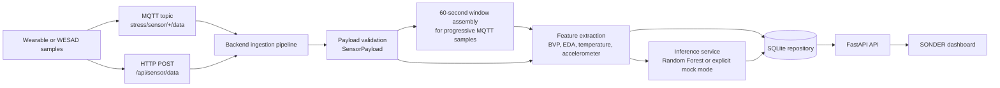

# SONDER

SONDER is a wearable-sensor stress-monitoring and prediction prototype. It accepts
raw physiological sensor windows through HTTP or MQTT, validates and stores those
windows, extracts deterministic features, and can score them with a scikit-learn
model. A lightweight HTML dashboard reads the backend's live telemetry, completed
windows, prediction history, and health status.

> **Project status:** The ingestion, preprocessing, persistence, API, MQTT, simulator,
> and dashboard code are present. The end-to-end stress-prediction pipeline still
> requires further runtime validation with the available model, WESAD archive, MQTT
> broker, and current sensor contract. This README does not claim production readiness
> or validated prediction performance.

## What is implemented

| Area | Current implementation | Status |
| --- | --- | --- |
| Sensor ingestion | Validated raw BVP, EDA, skin-temperature, and three-axis accelerometer windows; HTTP and progressive MQTT ingestion are supported. | Implemented in code |
| MQTT | `paho-mqtt` subscriber with TLS support, reconnect behavior, topic subscription, payload-size limits, topic/device validation, and a WESAD publisher simulator. | Implemented; broker-dependent |
| Preprocessing | Deterministic statistics, slopes, RMS values, accelerometer magnitude, EDA peak features, and an optional estimated heart rate. HRV is deliberately not fabricated. | Implemented |
| WESAD integration | Reads E4 CSV signals and original annotation pickles from the WESAD ZIP archive; produces aligned windows and binary `NON_STRESS`/`STRESS` labels for baseline/stress only. | Implemented; archive-dependent |
| ML inference | Loads a trusted joblib model beside JSON metadata, validates feature order, supports real-model and explicit mock modes, and records prediction status. | Implemented; runtime validation pending |
| Storage | SQLite repository for raw windows, prediction records, feature vectors, status, and errors. | Implemented |
| API | FastAPI health, sensor, prediction, and summary routes. | Implemented |
| Dashboard | `frontend/m1.html` displays backend-backed live telemetry, the latest completed window, prediction status/history, waveform views, health status, and CSV export of loaded prediction records. | Implemented; backend-dependent |
| Training/evaluation | Full-data deployment training, a fixed subject-independent baseline split, and leave-one-subject-out evaluation scripts. | Implemented as scripts; no checked-in evaluation report |

The dashboard intentionally displays unavailable values as unavailable. It does not
claim a sensor is connected unless the backend reports a receiving state.

## Data flow



An MQTT raw modality sample does not immediately become a completed prediction. The
pipeline maintains a per-device window and processes it when the configured raw
signals satisfy the expected 60-second window requirements. The live endpoint exposes
the most recently accepted MQTT sample independently of the completed analysis window.

## Technology stack

- **Python** with Pydantic Settings and standard-library modules.
- **FastAPI** and **Uvicorn** for the HTTP API and application lifecycle.
- **paho-mqtt** for MQTT subscriber/publisher communication.
- **SQLite** for persistence, using the standard-library `sqlite3` module.
- **NumPy**, **Pandas**, **SciPy**, and **scikit-learn** for the data/ML toolchain.
- **joblib** for loading and writing the trained model artifact.
- **pytest** for backend tests.
- **HTML, CSS, and JavaScript** for the dashboard.
- The dashboard currently loads Tailwind CSS and Google Fonts from CDNs; it has no
  frontend package manifest or Node.js build step.

## Repository structure

```text
stress-iot/
├── backend/
│   ├── app/
│   │   ├── api/routes.py           # FastAPI route definitions
│   │   ├── core/                   # Settings, errors, logging, time utilities
│   │   ├── database/               # Repository interface and SQLite implementation
│   │   ├── ml/                     # Inference service and predictor implementations
│   │   ├── mqtt/                   # MQTT parsing, subscriber, and publisher
│   │   ├── preprocessing/          # Feature extraction, WESAD loading, model spec
│   │   ├── schemas/                # Sensor, prediction, and stored-record contracts
│   │   ├── services/               # Ingestion pipeline, metrics, and summaries
│   │   ├── container.py            # Composition root
│   │   └── main.py                 # FastAPI application factory
│   ├── models/
│   │   └── stress_model.metadata.json
│   ├── scripts/
│   │   ├── evaluate_loso.py        # Leave-one-subject-out evaluation
│   │   ├── simulate_wesad.py       # Publish WESAD samples over MQTT
│   │   ├── train_baseline.py       # Fixed subject-independent baseline
│   │   └── train_final.py          # Full-data deployment training
│   ├── tests/                      # Backend unit/integration tests
│   ├── check_wesad.py              # Archive/window inspection helper
│   ├── pytest.ini
│   └── requirements.txt
├── frontend/
│   └── m1.html                     # SONDER dashboard
├── SONDER_PROJECT_CONTEXT.md       # Project context and audit notes
└── project_status_list.txt         # Project audit/status notes
```

Local datasets, SQLite databases, model binaries, caches, generated PDFs, manifests,
and environment files are intentionally omitted from the structure above.
`_foreign_versions_found_0533/` is an archived/foreign snapshot and is not part of
the active application package.

## Installation and setup on Windows

### Prerequisites

- Windows PowerShell.
- Python compatible with the pinned dependencies in `backend/requirements.txt`.
- A WESAD archive if training, archive inspection, or simulation is required.
- An MQTT broker and credentials if MQTT mode is enabled.

### Clone and create a virtual environment

Replace `<repository-url>` with the repository URL:

```powershell
git clone <repository-url>
Set-Location .\stress-iot

python -m venv .venv
.\.venv\Scripts\Activate.ps1
python -m pip install --upgrade pip
python -m pip install -r .\backend\requirements.txt
```

If PowerShell blocks activation, use the execution-policy guidance appropriate for
your machine or invoke the environment directly:

```powershell
.\.venv\Scripts\python.exe -m pip install -r .\backend\requirements.txt
```

### Configure the backend

The settings class reads `backend\.env` using `pydantic-settings`. The repository
does not currently provide a committed `.env.example`; create a local `backend\.env`
and never commit it. The recognized settings include:

| Variable | Default/meaning |
| --- | --- |
| `APP_ENV` | `development` |
| `APP_DEBUG` | `false` |
| `LOG_LEVEL` | `INFO` |
| `API_HOST` | `127.0.0.1` |
| `API_PORT` | `8000` |
| `CORS_ORIGINS` | Comma-separated origins; defaults include ports 5500, 3000, and 5173 |
| `DATABASE_URL` | SQLite URL; default is `sqlite:///./data/stress.db` |
| `INFERENCE_MODE` | `model` or explicit `mock` |
| `MODEL_PATH` | `models/stress_model.joblib` |
| `MODEL_METADATA_PATH` | `models/stress_model.metadata.json` |
| `MISSING_FEATURE_POLICY` | `reject` or `impute` |
| `DEFAULT_WINDOW_SECONDS` | `60.0` |
| `DEFAULT_BVP_SAMPLE_RATE_HZ` | `64.0` |
| `DEFAULT_EDA_SAMPLE_RATE_HZ` | `4.0` |
| `DEFAULT_TEMPERATURE_SAMPLE_RATE_HZ` | `4.0` |
| `DEFAULT_ACCELEROMETER_SAMPLE_RATE_HZ` | `32.0` |
| `MQTT_ENABLED` | `true` |
| `MQTT_BROKER_HOST` | Broker hostname; provide locally |
| `MQTT_BROKER_PORT` | `8883` |
| `MQTT_USERNAME` | Optional broker username |
| `MQTT_PASSWORD` | Optional broker password; keep secret |
| `MQTT_USE_TLS` | `true` |
| `MQTT_CLIENT_ID` | `stress-backend` |
| `MQTT_TOPICS` | `stress/sensor/+/data` |
| `MQTT_QOS` | `1` |
| `MQTT_KEEPALIVE` | `60` seconds |
| `MQTT_MAX_PAYLOAD_BYTES` | `16384` |

Relative database and model paths are resolved under `backend\`, not the current
working directory. The default model mode does not silently fall back to mock
predictions. Mock mode is explicit and its outputs are marked as mock.

### Start the backend

Run from the `backend` directory:

```powershell
Set-Location .\backend
python -m app
```

The application reads `API_HOST`, `API_PORT`, and `APP_DEBUG`. The equivalent
development command is:

```powershell
uvicorn app.main:create_app --factory --host 127.0.0.1 --port 8000 --reload
```

With the default configuration, the API is available at
`http://127.0.0.1:8000`. Swagger UI is at
`http://127.0.0.1:8000/docs`, and the OpenAPI document is at
`http://127.0.0.1:8000/openapi.json`.

### Launch the frontend

The frontend is a static HTML file. From a second PowerShell window:

```powershell
Set-Location .\frontend
python -m http.server 5500
```

Open `http://127.0.0.1:5500/m1.html`. The dashboard JavaScript currently targets
`http://localhost:8000`; use a backend reachable at that address or update the
frontend configuration as part of a separately reviewed deployment change.

### Run the WESAD simulator

The simulator publishes actual WESAD E4 samples progressively over MQTT. Run it
from `backend` after configuring the broker and placing the archive at the default
path `backend\data\archive (8).zip`:

```powershell
Set-Location .\backend
python .\scripts\simulate_wesad.py --subject S2 --speed 10 --max-windows 1
```

Available arguments are:

```text
--archive PATH          WESAD ZIP path
--subject SUBJECT      WESAD subject ID, default S2
--speed MULTIPLIER     Simulated-time multiplier, must be positive
--topic TOPIC          Override the configured publish topic
--max-windows COUNT    Optional maximum number of 60-second windows
--connect-timeout SEC  MQTT connection timeout, default 10 seconds
```

The simulator derives a device ID such as `wesad-s2` and publishes to the configured
device topic, normally `stress/sensor/wesad-s2/data`.

## API reference

All routes are registered by `backend/app/api/routes.py`.

| Method | Endpoint | Purpose | Parameters |
| --- | --- | --- | --- |
| `GET` | `/health` | Reports database, MQTT, inference, and pipeline status. | None |
| `GET` | `/api/sensor/latest` | Returns the latest persisted sensor window. | Optional `device_id` query parameter |
| `GET` | `/api/sensor/live` | Returns the latest accepted MQTT sample, independent of a completed window. | Optional `device_id` query parameter |
| `POST` | `/api/sensor/data` | Validates and persists a complete raw sensor window, using the same pipeline as MQTT. | JSON body; see below |
| `GET` | `/api/predictions/latest` | Returns the latest persisted prediction. | Optional `device_id` query parameter |
| `GET` | `/api/predictions` | Lists persisted predictions. | `limit` 1–1000, `offset` ≥ 0, optional `device_id`, `since`, and `until` ISO-8601 timestamps |
| `GET` | `/api/summary` | Aggregates reading and prediction counts and feature statistics. | `window_minutes` 1–43200, optional `device_id` |

### Complete sensor-window request

`POST /api/sensor/data` accepts raw arrays. `bvp` may also be supplied as `ppg`,
and `eda` may also be supplied as `gsr`. Accelerometer axes must have equal
lengths; all signals must be non-empty and finite.

```json
{
  "device_id": "wearable-001",
  "subject_id": "S2",
  "user_id": "user-1",
  "session_id": "session-1",
  "timestamp": "2026-01-01T12:00:00Z",
  "window_seconds": 60,
  "sample_rates_hz": {
    "bvp": 64,
    "eda": 4,
    "skin_temperature": 4,
    "acc_x": 32,
    "acc_y": 32,
    "acc_z": 32
  },
  "bvp": [0.0],
  "eda": [0.0],
  "skin_temperature": [33.5],
  "acc_x": [0.01],
  "acc_y": [0.02],
  "acc_z": [0.98]
}
```

The response is a `ProcessingResult` containing `status`, optional `error`, the
stored `reading`, and an optional `prediction`. Prediction status can indicate
that a reading was stored without a prediction, for example when the model is
unavailable or preprocessing fails.

### MQTT raw-sample payload

The progressive MQTT path accepts modality messages on a configured topic such as
`stress/sensor/<device-id>/data`. BVP, EDA, and skin-temperature messages contain
`value`; accelerometer messages contain `acc_x`, `acc_y`, and `acc_z`.

```json
{
  "subject_id": "S2",
  "timestamp": "2026-01-01T12:00:00Z",
  "modality": "bvp",
  "sample_rate_hz": 64,
  "value": 0.25
}
```

The backend derives the device ID from the topic, rejects topic/payload mismatches,
and assembles samples into per-device windows.

## Machine-learning pipeline

### Dataset and modalities

The WESAD loader reads the Empatica E4 data included in the WESAD ZIP layout:

- BVP/PPG
- EDA/GSR
- Skin temperature
- Three-axis accelerometer
- Original WESAD annotation series from the participant pickle

The active binary target maps WESAD label `1` (`BASELINE`) to `NON_STRESS` and
label `2` (`STRESS`) to `STRESS`. Undefined, amusement, meditation, and unknown
labels are excluded from the initial binary target. Windows crossing annotation
transitions are not assigned a fabricated majority label.

### Features

The deployed metadata lists 27 features:

```text
bvp_mean, bvp_std, bvp_range, bvp_slope, bvp_rms
eda_mean, eda_std, eda_range, eda_slope
eda_peak_count, eda_peak_mean_amplitude, eda_peak_max_amplitude
skin_temperature_mean, skin_temperature_std, skin_temperature_range, skin_temperature_slope
acc_x_mean, acc_x_std, acc_y_mean, acc_y_std, acc_z_mean, acc_z_std
acc_magnitude_mean, acc_magnitude_std, acc_magnitude_range
acc_magnitude_rms, acc_magnitude_mean_abs_diff
```

The code can estimate heart rate from sufficiently regular BVP peaks, but that
optional estimate is not part of the deployed 27-feature order. The feature module
does not create HRV from insufficient information.

### Training and evaluation scripts

- `train_final.py` loads all available subjects, prepares binary 60-second windows,
  trains a `RandomForestClassifier` with 300 estimators, `random_state=42`,
  `class_weight="balanced"`, and `n_jobs=-1`, then writes the joblib model and JSON
  metadata. It is a full-data deployment-training script and does not report an
  evaluation score.
- `train_baseline.py` uses a fixed subject-independent split with `S13`, `S14`,
  `S15`, and `S16` as test subjects. It prints accuracy, classification report,
  confusion matrix, and ROC-AUC when both test classes are present.
- `evaluate_loso.py` trains and evaluates one model per held-out subject and prints
  accuracy, precision, recall, F1, and conditional ROC-AUC averages.

The checked-in metadata records 434 usable training rows from 15 subjects and a
window summary of 1,774 total candidate windows, with 282 non-stress, 152 stress,
and 1,340 excluded windows. These are preparation counts, not accuracy or
generalization results. No evaluation report or performance metric is checked into
the repository.

The backend loads `backend\models\stress_model.metadata.json` into a validated
model specification and loads `backend\models\stress_model.joblib` with joblib.
Only trusted model files should be loaded because joblib uses pickle-based
serialization.

## Testing

Run the configured suite from `backend`:

```powershell
Set-Location .\backend
python -m pytest -q
```

The tests cover API health and storage flows, inference service behavior, ingestion
and window handling, MQTT parsing/subscriber behavior, preprocessing, sensor
validation, SQLite persistence, and WESAD loading.

The current repository is not test-clean: the existing suite contains older scalar
sensor fixtures and references that are inconsistent with the active raw-window
schema, and collection currently reports a missing `parse_sensor_payload` import in
`tests/test_sensor_validation.py`. Treat test results as a validation task still in
progress rather than as evidence of production readiness.

## Limitations and future work

### Current limitations

- End-to-end runtime validation of the prediction pipeline remains pending.
- Runtime operation depends on the WESAD archive, model artifact, valid environment
  configuration, and an MQTT broker when MQTT is enabled.
- The default model mode reports model-unavailable status instead of silently
  fabricating predictions when the artifact cannot be loaded.
- Mock mode exists for plumbing tests only; its output has no physiological meaning
  and is marked `is_mock`.
- The frontend is a static HTML page with a hard-coded local API base URL and CDN
  dependencies.
- There is no committed `.env.example`.
- The repository has no root license file.
- Existing tests and some archived/legacy modules document an older scalar sensor
  contract and need alignment with the active raw-window implementation.

### Reasonable future work

- Reconcile and update stale tests to the raw BVP/EDA/temperature/accelerometer
  contract.
- Run and archive subject-independent and LOSO evaluation outputs.
- Validate the complete MQTT → window → preprocessing → model → API flow against a
  real broker and WESAD simulator.
- Add a safe `.env.example` containing placeholders only.
- Make the frontend API base URL configurable for deployment.
- Add a documented non-medical-use disclaimer and deployment hardening.

## Security

- Never commit `backend\.env`, passwords, tokens, broker credentials, or private
  certificates.
- Use `SecretStr`-backed `MQTT_PASSWORD` configuration and verify logs do not expose
  credentials.
- Keep model artifacts trusted before loading them with joblib.
- Do not paste real broker host credentials into issues, documentation, screenshots,
  or test fixtures.
- The repository `.gitignore` excludes environment files, datasets, model binaries,
  databases, caches, logs, and generated reports.

## Contributing

1. Create a focused branch.
2. Keep changes scoped to the active architecture and raw sensor contract.
3. Do not commit generated databases, datasets, model binaries, `.env` files, or
   credentials.
4. Add or update tests for behavioral changes.
5. Run syntax checks and the relevant pytest selectors.
6. Document any API, MQTT payload, model metadata, or configuration contract change.
7. Report known limitations honestly, especially when hardware, broker, model, or
   dataset validation is unavailable.

## Acknowledgements

SONDER uses the WESAD (Wearable Stress and Affect Detection) dataset format and
Empatica E4 modalities in its loader and simulator. Follow the WESAD dataset's
original access terms, citation requirements, and research-use conditions. The
repository does not include a separate license file; **no project license has been
specified**.
