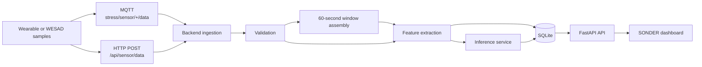

# SONDER

SONDER is an ongoing engineering project focused on wearable-based stress
monitoring and prediction. The repository contains an initial implementation of
the backend, sensor-data pipeline, machine-learning components, MQTT
communication, and dashboard.

The project is still under development. Several parts need more testing,
improvement, and integration before the system can be considered complete. The
current version should be treated as a development prototype, not as a finished
or production-ready system.

## What the project currently does

SONDER accepts raw wearable sensor data through HTTP or MQTT. The backend
validates the data, builds 60-second windows for progressive MQTT samples,
extracts features, optionally runs a scikit-learn model, and stores the results
in SQLite. The dashboard reads this information from the API.

The current sensor pipeline works with:

- Blood volume pulse (BVP/PPG)
- Electrodermal activity (EDA/GSR)
- Skin temperature
- Three-axis accelerometer data

The repository also includes a WESAD data loader, training scripts, evaluation
scripts, and a simulator that publishes WESAD samples over MQTT.

The dashboard shows live telemetry separately from the latest completed
analysis window. It also shows prediction status and history, waveform data,
backend health, and can export the prediction records it has loaded. Values are
shown as unavailable when the backend has not received them; the interface does
not pretend that a sensor is connected.

The main pieces are present, but the complete prediction path still needs
end-to-end testing with the model, WESAD archive, MQTT broker, and current
sensor format. Model performance has not yet been established through a final,
documented evaluation.

## How the system works



An MQTT sample is not immediately treated as a completed prediction. Samples
are collected per device until the required window is complete. The live
telemetry endpoint is separate from this completed-window process.

The backend can run in `model` mode or in an explicit `mock` mode for plumbing
tests. Mock results are marked as mock and do not represent meaningful
physiological predictions. If the real model cannot be loaded, the backend
stores the reading without inventing a prediction.

## Technologies

- Python
- FastAPI and Uvicorn
- Pydantic Settings
- paho-mqtt
- SQLite
- NumPy, Pandas, SciPy, and scikit-learn
- joblib
- pytest
- HTML, CSS, and JavaScript

The dashboard is a static HTML page. It currently uses Tailwind CSS and Google
Fonts from CDNs and does not have a Node.js build step or frontend package
manifest.

## Project structure

```text
stress-iot/
├── backend/
│   ├── app/
│   │   ├── api/routes.py           # FastAPI routes
│   │   ├── core/                   # Settings, errors, logging, time helpers
│   │   ├── database/               # Repository interface and SQLite storage
│   │   ├── ml/                     # Inference service and predictors
│   │   ├── mqtt/                   # MQTT parsing and subscriber support
│   │   ├── preprocessing/          # Features, model spec, and WESAD loading
│   │   ├── schemas/                # Sensor and response models
│   │   ├── services/               # Ingestion pipeline and summaries
│   │   ├── container.py            # Application wiring
│   │   └── main.py                 # FastAPI application factory
│   ├── models/
│   │   └── stress_model.metadata.json
│   ├── scripts/
│   │   ├── evaluate_loso.py        # Leave-one-subject-out evaluation
│   │   ├── simulate_wesad.py       # WESAD-to-MQTT simulator
│   │   ├── train_baseline.py       # Subject-independent baseline
│   │   └── train_final.py          # Full-data model training
│   ├── tests/                      # Backend tests
│   ├── check_wesad.py              # WESAD inspection helper
│   ├── pytest.ini
│   └── requirements.txt
├── frontend/
│   └── m1.html                     # SONDER dashboard
├── SONDER_PROJECT_CONTEXT.md
└── project_status_list.txt
```

Datasets, databases, model binaries, caches, generated PDFs, manifests, and
environment files are not shown above. The archived
`_foreign_versions_found_0533/` directory is not part of the active
application package.

## Setup on Windows

### Requirements

You will need:

- Windows PowerShell
- A Python version compatible with `backend\requirements.txt`
- The WESAD archive for training, inspection, or simulation
- An MQTT broker and credentials if MQTT is enabled

### Create the environment

Replace `<repository-url>` with the repository URL:

```powershell
git clone <repository-url>
Set-Location .\stress-iot

python -m venv .venv
.\.venv\Scripts\Activate.ps1
python -m pip install --upgrade pip
python -m pip install -r .\backend\requirements.txt
```

If PowerShell activation is restricted, the environment can be used directly:

```powershell
.\.venv\Scripts\python.exe -m pip install -r .\backend\requirements.txt
```

### Backend configuration

Settings are read from `backend\.env` using `pydantic-settings`. There is no
committed `.env.example` yet, so create the file locally and do not commit it.

| Variable | Default or purpose |
| --- | --- |
| `APP_ENV` | `development` |
| `APP_DEBUG` | `false` |
| `LOG_LEVEL` | `INFO` |
| `API_HOST` | `127.0.0.1` |
| `API_PORT` | `8000` |
| `CORS_ORIGINS` | Comma-separated allowed origins |
| `DATABASE_URL` | `sqlite:///./data/stress.db` |
| `INFERENCE_MODE` | `model` or explicit `mock` |
| `MODEL_PATH` | `models/stress_model.joblib` |
| `MODEL_METADATA_PATH` | `models/stress_model.metadata.json` |
| `MISSING_FEATURE_POLICY` | `reject` or `impute` |
| `DEFAULT_WINDOW_SECONDS` | `60.0` |
| `DEFAULT_BVP_SAMPLE_RATE_HZ` | `64.0` |
| `DEFAULT_EDA_SAMPLE_RATE_HZ` | `4.0` |
| `DEFAULT_TEMPERATURE_SAMPLE_RATE_HZ` | `4.0` |
| `DEFAULT_ACCELEROMETER_SAMPLE_RATE_HZ` | `32.0` |
| `MQTT_ENABLED` | `true` |
| `MQTT_BROKER_HOST` | Local broker hostname |
| `MQTT_BROKER_PORT` | `8883` |
| `MQTT_USERNAME` | Optional broker username |
| `MQTT_PASSWORD` | Optional broker password; keep it secret |
| `MQTT_USE_TLS` | `true` |
| `MQTT_CLIENT_ID` | `stress-backend` |
| `MQTT_TOPICS` | `stress/sensor/+/data` |
| `MQTT_QOS` | `1` |
| `MQTT_KEEPALIVE` | `60` |
| `MQTT_MAX_PAYLOAD_BYTES` | `16384` |

Relative database and model paths are resolved under `backend\`. MQTT passwords
are represented as secret settings and masked in the backend's safe
configuration output.

### Start the backend

Run the backend from its directory:

```powershell
Set-Location .\backend
python -m app
```

For development with reload:

```powershell
uvicorn app.main:create_app --factory --host 127.0.0.1 --port 8000 --reload
```

The default API address is `http://127.0.0.1:8000`.

- Swagger UI: `http://127.0.0.1:8000/docs`
- OpenAPI JSON: `http://127.0.0.1:8000/openapi.json`

### Start the dashboard

The dashboard is a static file. In a second PowerShell window:

```powershell
Set-Location .\frontend
python -m http.server 5500
```

Open `http://127.0.0.1:5500/m1.html`. The current dashboard points to a backend
at `http://localhost:8000`.

### Run the WESAD simulator

Place the WESAD archive at `backend\data\archive (8).zip`, configure MQTT, and
run:

```powershell
Set-Location .\backend
python .\scripts\simulate_wesad.py --subject S2 --speed 10 --max-windows 1
```

The simulator supports:

```text
--archive PATH          WESAD ZIP path
--subject SUBJECT       Subject ID, default S2
--speed MULTIPLIER      Simulated-time multiplier; must be positive
--topic TOPIC           Override the configured topic
--max-windows COUNT     Optional limit on 60-second windows
--connect-timeout SEC   MQTT connection timeout, default 10 seconds
```

It creates device IDs such as `wesad-s2` and normally publishes to
`stress/sensor/wesad-s2/data`.

## API overview

The routes are defined in `backend/app/api/routes.py`.

| Method | Endpoint | Purpose |
| --- | --- | --- |
| `GET` | `/health` | Reports database, MQTT, inference, and pipeline status |
| `GET` | `/api/sensor/latest?device_id=...` | Gets the latest stored sensor window |
| `GET` | `/api/sensor/live?device_id=...` | Gets the latest accepted MQTT sample |
| `POST` | `/api/sensor/data` | Submits a complete sensor window over HTTP |
| `GET` | `/api/predictions/latest?device_id=...` | Gets the latest stored prediction |
| `GET` | `/api/predictions` | Lists predictions |
| `GET` | `/api/summary` | Returns reading and prediction summaries |

For `/api/predictions`, the available query parameters are `limit` (1–1000),
`offset` (0 or greater), `device_id`, `since`, and `until`. For `/api/summary`,
`window_minutes` ranges from 1 to 43,200, with an optional `device_id`.

### Sensor-window request

`POST /api/sensor/data` accepts raw arrays. `bvp` can also be called `ppg`, and
`eda` can also be called `gsr`. Accelerometer axes must have the same length.

```json
{
  "device_id": "wearable-001",
  "subject_id": "S2",
  "timestamp": "2026-01-01T12:00:00Z",
  "window_seconds": 60,
  "sample_rates_hz": {
    "bvp": 64,
    "eda": 4,
    "skin_temperature": 4,
    "acc_x": 32,
    "acc_y": 32,
    "acc_z": 32
  },
  "bvp": [0.0],
  "eda": [0.0],
  "skin_temperature": [33.5],
  "acc_x": [0.01],
  "acc_y": [0.02],
  "acc_z": [0.98]
}
```

The response includes the processing status, stored reading, optional error,
and optional prediction. A reading can be stored even when a prediction is not
available.

### MQTT sample

Progressive MQTT messages are published on a topic such as
`stress/sensor/<device-id>/data`. BVP, EDA, and skin-temperature messages use
`value`; accelerometer messages use `acc_x`, `acc_y`, and `acc_z`.

```json
{
  "subject_id": "S2",
  "timestamp": "2026-01-01T12:00:00Z",
  "modality": "bvp",
  "sample_rate_hz": 64,
  "value": 0.25
}
```

The backend takes the device ID from the topic, checks it against any payload
value, and assembles samples into per-device windows.

## Machine learning and WESAD

The WESAD loader reads Empatica E4 data from the WESAD ZIP archive:

- BVP/PPG
- EDA/GSR
- Skin temperature
- Three-axis accelerometer
- Original participant annotations

For the binary task, WESAD label `1` (`BASELINE`) becomes `NON_STRESS` and label
`2` (`STRESS`) becomes `STRESS`. Undefined, amusement, meditation, and unknown
labels are excluded. Windows crossing label transitions are not assigned a
made-up majority label.

The deployed model metadata defines 27 features:

```text
bvp_mean, bvp_std, bvp_range, bvp_slope, bvp_rms
eda_mean, eda_std, eda_range, eda_slope
eda_peak_count, eda_peak_mean_amplitude, eda_peak_max_amplitude
skin_temperature_mean, skin_temperature_std, skin_temperature_range, skin_temperature_slope
acc_x_mean, acc_x_std, acc_y_mean, acc_y_std, acc_z_mean, acc_z_std
acc_magnitude_mean, acc_magnitude_std, acc_magnitude_range
acc_magnitude_rms, acc_magnitude_mean_abs_diff
```

The feature code includes an optional heart-rate estimate from BVP peaks, but
that estimate is not part of the deployed 27-feature order. HRV is not created
without a validated beat-to-beat pipeline.

The training scripts have different purposes:

- `train_final.py` trains a 300-tree balanced `RandomForestClassifier` on all
  available training windows and writes the model and metadata. It is for
  deployment training, not for reporting a final score.
- `train_baseline.py` uses a fixed subject-independent holdout and prints
  accuracy, a classification report, a confusion matrix, and ROC-AUC when
  applicable.
- `evaluate_loso.py` performs leave-one-subject-out evaluation and prints
  accuracy, precision, recall, F1, and conditional ROC-AUC averages.

The checked-in metadata records 434 usable training rows from 15 subjects. It
also records 1,774 candidate windows: 282 non-stress, 152 stress, and 1,340
excluded. These are preparation counts, not performance results. No final
evaluation report or verified accuracy is included in the repository.

The backend loads `backend\models\stress_model.metadata.json` as the model
contract and loads `backend\models\stress_model.joblib` with joblib. Only trusted
model files should be loaded because joblib uses pickle-based serialization.

## Tests and known issues

Run the configured test suite from `backend`:

```powershell
Set-Location .\backend
python -m pytest -q
```

The tests cover API flows, ingestion and window handling, inference behavior,
MQTT parsing, preprocessing, sensor validation, SQLite persistence, and WESAD
loading.

The test suite is still being brought in line with the active raw-window
pipeline. Some tests use older scalar sensor fields, and collection currently
reports a missing `parse_sensor_payload` import in
`tests/test_sensor_validation.py`. Tests should therefore be treated as ongoing
development work, not as proof that the full system is ready.

## Current limitations and next steps

The main areas still being worked on are:

- Complete end-to-end testing of MQTT ingestion, window assembly, preprocessing,
  model loading, prediction, storage, and dashboard display.
- A documented subject-independent or LOSO evaluation of model performance.
- Updating older tests and components to use the current raw sensor-window
  format.
- Testing with the WESAD simulator and a real MQTT broker.
- Making the dashboard API address configurable instead of relying on the local
  development address.
- Adding a safe `.env.example` with placeholders.
- Further refinement of the dashboard and backend integration.

The architecture and feature set may change as these pieces are tested and
improved. That is expected for the current stage of the project.

## Contributing

If you are working on SONDER:

1. Keep changes focused on the active sensor-window architecture.
2. Do not commit `.env` files, credentials, datasets, model binaries, databases,
   or generated reports.
3. Add or update tests when behavior changes.
4. Run the relevant tests and syntax checks before opening a change.
5. Document changes to API routes, MQTT payloads, model metadata, or settings.
6. Note clearly when hardware, broker, model, or dataset validation was not
   available.

## Security notes

Keep broker credentials, passwords, tokens, and private certificates out of the
repository. `MQTT_PASSWORD` is handled as a secret setting and is masked in
safe configuration output. Model files loaded with joblib should also be treated
as trusted inputs.

## Acknowledgements and license

SONDER uses the WESAD dataset format and Empatica E4 modalities in its loader
and simulator. Follow the WESAD dataset's access terms and citation
requirements when using it.

No license file is currently included in the repository, so no project license
has been specified.
